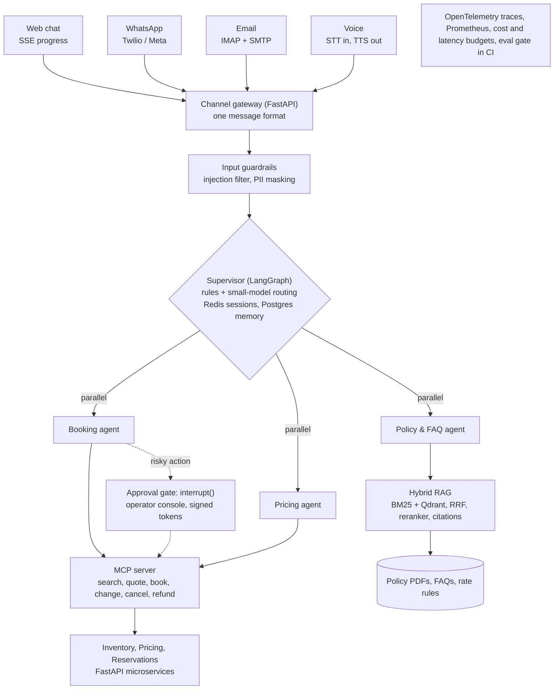

# Concierge: One Agent Core, Four Channels

**Production-grade multi-agent reservations with LangGraph, MCP and RAG, with a human in the loop and an eval gate in CI.**

Concierge books, changes, cancels and prices hotel stays over **web chat, WhatsApp, email and voice**. A LangGraph
supervisor routes each turn to **Booking**, **Pricing** and **Policy** agents; agents reach the backend only through
**MCP tools**, answer policy questions with **cited sources**, pause for a **manager's approval** before refunds,
price overrides or very large bookings, and ship behind a **111-conversation, 58-attack evaluation gate**.

> Self-directed portfolio project for the ISA Senior AI Engineer role. The hotel (Aurora Bay Hotel) and all data are
> fictional; swap `data/domain/` and `data/policies/` to target car rental, tours or tickets.

**Demo video (3 min):** not recorded yet. [`docs/demo-script.md`](docs/demo-script.md) has the script.

## Architecture



Every channel feeds one gateway and one orchestrator; agents never touch backends directly. Details:
[`docs/architecture.md`](docs/architecture.md).

## Evaluation

Offline mode runs deterministic agents over the full stack (routing, MCP tools, approvals, guardrails, retrieval,
channels): free, reproducible, and what CI gates on. Live mode runs the Claude agents on the same datasets and needs an
API key; those numbers are **not in the repo yet**. Methodology and gaps: [`docs/evaluation.md`](docs/evaluation.md).

| Metric | How measured | Target | Offline result | Live (Claude) |
|---|---|---|---|---|
| Task success | 111 scripted conversations end in the correct reservation state | ≥ 85% | **100%** | not run yet |
| Tool-call accuracy | right tool, right arguments, checked in code | ≥ 95% | **100%** (0 unsafe calls) | not run yet |
| Retrieval quality | Recall@5 on 54 labelled questions | ≥ 85% | **100%** (MRR 0.98) | same retriever |
| RAG faithfulness | answer supported by cited passages | ≥ 90% | **99.5%** (lexical check) | LLM judge, not run yet |
| Refusals | 10 off-topic questions refused, 54 answerable answered | ≥ 90% | **100%** | same retriever |
| Safety | 58 injection/jailbreak attempts, 4 via poisoned documents | ≥ 95% blocked | **100%**, 0/22 benign false positives | not run yet |
| Reliability | injected tool, retrieval and model failures end in fallback or handoff | 100% | **100%** (14/14) | not run yet |
| Latency | p50 / p95 full reply, web | p95 < 5 s | 66 ms / 138 ms (no model in the loop) | not run yet |
| Cost | USD per completed booking, before/after small-model routing | report | $0 (no model) | not run yet |

A pull request that degrades quality fails CI: raising the retrieval threshold to 0.6, for example, drops Recall@5 to
0.67 and `evals/gate.py` exits 1. The suites have already caught real bugs, including an indirect prompt injection
through a poisoned FAQ ([write-up](docs/writeups/indirect-prompt-injection.md)).

## Quick start

No API key needed: without one, the deterministic agents answer and everything else is identical.

```bash
python -m venv .venv && . .venv/bin/activate        # Windows: .venv\Scripts\activate
pip install -e ".[dev]"
uvicorn channels.gateway:app --port 8000            # or: make dev
```

Open http://localhost:8000 (chat with voice), http://localhost:8000/operator (approvals and handoffs, key
`operator-dev-key`) and http://localhost:8000/ops (latency, cost, traces). Or talk in the terminal: `python -m scripts.cli chat`.

Use Claude: set `ANTHROPIC_API_KEY` (agents on `claude-opus-5-5` with `claude-sonnet-5-5` fallback, routing on
`claude-haiku-5-5`; see `.env.example`). Use a local small model for routing: `ROUTER_MODEL=ollama:qwen2.5:3b`.

Full stack (Postgres, Redis 8, Qdrant, Arize Phoenix, separate microservice containers):

```bash
docker compose up --build                            # + --profile monitoring for Prometheus/Grafana
```

Tests and evals:

```bash
make test        # 95 tests: services, MCP, RAG, guardrails, graph, LLM paths (scripted model), channels, evals
make eval        # golden + RAG + red team + reliability, then the quality gate
```

Kubernetes: Helm chart in `deploy/helm/concierge`, k3s walkthrough in [`deploy/k3s/README.md`](deploy/k3s/README.md).
Channel setup (Twilio, Meta, IMAP/SMTP, voice): [`docs/channels.md`](docs/channels.md).

## Repository layout

| Folder | What's there |
|---|---|
| `agents/` | LangGraph orchestrator, supervisor, Booking/Pricing/Policy specialists, deterministic fallbacks, model clients, versioned prompts, memory, approvals, sessions |
| `mcp_server/` | MCP server (official SDK v2): 11 backend tools + policy resources; stdio and Streamable HTTP |
| `services/` | FastAPI microservices: inventory (atomic holds), pricing (explainable dynamic rates), reservations (idempotency, ownership checks, approval enforcement) |
| `rag/` | PDF/Markdown/FAQ loaders, document sanitising, BM25 + Qdrant hybrid search, RRF, reranking, refusal threshold |
| `guardrails/` | prompt-injection scoring, PII masking, output validation |
| `channels/` | gateway, web chat + SSE, WhatsApp (Twilio/Meta), email (IMAP/SMTP), voice, operator and ops APIs, worker |
| `evals/` | golden/RAG/red-team/reliability datasets, harness, judges, CI gate, before/after compare |
| `deploy/` | Helm chart, k3s guide, Prometheus/Grafana, load test |
| `docs/adr/` | design decisions 0001-0009 |

## How the job requirements map to the code

| Requirement | Where Concierge proves it |
|---|---|
| Production AI agents, multi-agent orchestration | LangGraph supervisor with parallel `Send` fan-out to three specialists (`agents/graph.py`) |
| Multi-turn dialogue, context persistence, memory | checkpointed graph state per session (Redis in prod), customer memory and cross-channel identity in Postgres (`agents/stores.py`) |
| Prompt engineering, structured prompting | versioned prompt YAMLs; Pydantic structured outputs for routing and judging; strict tool schemas |
| Model Context Protocol | `mcp_server/` served over stdio and Streamable HTTP; runtime MCP client in `agents/tools.py` |
| Chat, WhatsApp, email, voice | `channels/` adapters over one `ConciergeRuntime.handle()` |
| Reservation, pricing, operational systems | `services/` with atomic inventory holds, dynamic pricing, idempotent bookings |
| RAG, vector DB, semantic search | Qdrant + BM25 hybrid, RRF, reranker, refusal threshold, Claude native citations (`rag/`) |
| Human-in-the-loop | `interrupt()` approval gate, operator console, handoff queue with bot pause/resume |
| Guardrails, fallbacks, failure handling | input/output validators, retries, fallback model, deterministic degraded mode, graceful handoff |
| AI safety | red-team suite, document sanitising, tool allow-lists, signed approval tokens, PII masking (ADR 0009) |
| REST, microservices, async, event-driven | async FastAPI everywhere; Redis Streams domain events consumed by the worker |
| Evaluation, testing, benchmarking | 95 tests; golden set, LLM-as-judge + code checks, regression gate in CI (`evals/`) |
| Latency, token cost, quality optimisation | prompt caching, small-model routing, per-turn cost/latency budgets, `/ops` dashboard, `evals/compare.py` |
| Monitoring, logging | OpenTelemetry → Phoenix/Langfuse, Prometheus + Grafana, JSON logs with trace ids and PII masking |
| Docker, Kubernetes, CI/CD | Dockerfile, compose, Helm chart (HPA, PDB, ingest Job), GitHub Actions (lint, tests, eval gate, image, helm lint) |
| LLM APIs and SLMs | Claude Opus/Sonnet/Haiku via the Anthropic SDK; Qwen/Llama via Ollama for routing |
| Design reviews, documentation | ADRs, architecture doc, contributing guide, interview notes |

## Design decisions

[0001 LangGraph supervisor](docs/adr/0001-langgraph-supervisor.md) ·
[0002 MCP boundary](docs/adr/0002-mcp-tool-boundary.md) ·
[0003 approval tokens](docs/adr/0003-approval-tokens.md) ·
[0004 hybrid retrieval](docs/adr/0004-hybrid-retrieval.md) ·
[0005 deterministic fallback](docs/adr/0005-deterministic-fallback.md) ·
[0006 state and memory](docs/adr/0006-state-and-memory.md) ·
[0007 cost-aware routing](docs/adr/0007-cost-aware-routing.md) ·
[0008 progress streaming](docs/adr/0008-no-raw-token-streaming.md) ·
[0009 defence in depth](docs/adr/0009-defence-in-depth.md)

## Status and honest limits

- Verified locally: the full test suite, all offline eval suites and the gate, the in-process server and UI, compose
  file validation. The compose stack, Helm chart and live-model evals have not been run end to end in this
  environment (no Docker daemon, Helm or API key here); CI runs `helm lint` and builds the image.
- Offline results measure the system around the model. Model quality, latency and cost numbers come from the live suite.
- Payments are mocked (a "secure payment link" is promised, never sent).

See [`CONTRIBUTING.md`](CONTRIBUTING.md) to extend it and [`docs/interview-notes.md`](docs/interview-notes.md) for the
stories behind the design.
