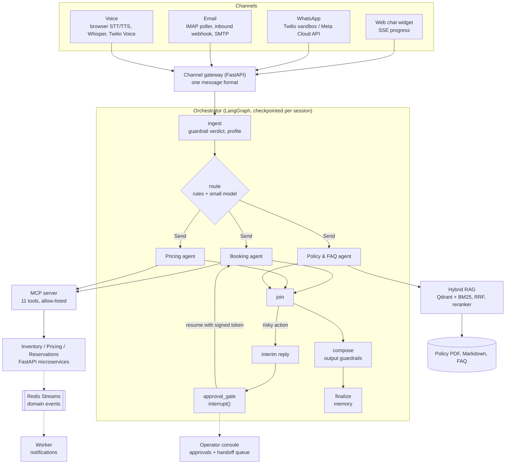
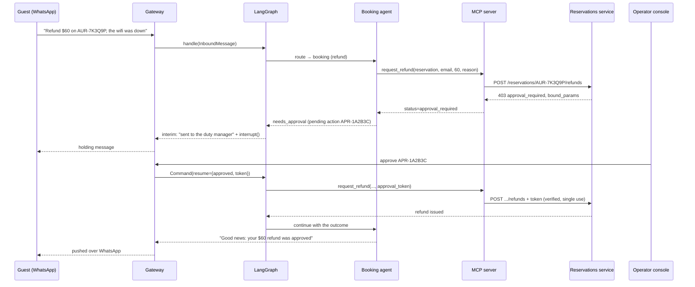

# Architecture

Concierge is one agent core behind one channel gateway. Every channel is normalised into an `InboundMessage`,
handled by the same LangGraph orchestrator, and rendered back per channel. Agents never touch backends directly:
backend actions go through MCP tools, knowledge comes from the RAG pipeline.

## Request lifecycle: a refund that needs approval

## Components

| Component | Path | Notes |
|---|---|---|
| Channel gateway | `channels/gateway.py` | FastAPI app; in `inprocess` topology also hosts the services (`/svc/*`) and the MCP server over Streamable HTTP (`/mcp/`) |
| Web chat | `channels/web.py`, `channels/web/static/` | REST, SSE with progress events, outbox polling for async messages, browser voice |
| WhatsApp | `channels/whatsapp.py` | Twilio (signature-validated, TwiML) and Meta Cloud API (verify token, `X-Hub-Signature-256`, Graph API sends) |
| Email | `channels/email_channel.py` | IMAP poller, inbound-parse webhook, quote/signature stripping, threaded SMTP replies |
| Voice | `channels/voice.py` | browser STT/TTS, server Whisper (`faster-whisper`), Twilio Voice `<Gather>`/`<Say>` |
| Operator API + console | `channels/operator.py`, `operator.html` | approvals, handoffs (claim pauses the bot, close resumes it), transcripts |
| Ops | `channels/ops.py`, `ops.html` | health, Prometheus, latency/cost dashboard, recent traces with a span waterfall |
| Orchestrator | `agents/graph.py`, `agents/runtime.py` | graph, per-session locking, approvals, operator replies, delivery |
| Supervisor | `agents/router.py`, `agents/nlu.py` | deterministic rules + optional small model with structured output |
| Specialists | `agents/specialists.py`, `agents/offline.py` | Claude tool loop, cited policy answers, deterministic fallback |
| Tool gateway | `agents/tools.py` | MCP client, strict schemas, allow-lists, retries, fault injection |
| Model clients | `agents/llm/` | Claude (caching, effort, server-side fallbacks, typed errors), Ollama |
| Prompts | `agents/prompts/*.yaml` | versioned; the version is attached to spans and eval reports |
| Stores | `agents/stores.py`, `agents/checkpoint.py` | customer memory, approvals/handoffs, sessions/outbox, checkpointers |
| MCP server | `mcp_server/` | 11 tools + policy resources; stdio and HTTP transports |
| Microservices | `services/` | inventory (atomic holds), pricing (explainable dynamic rates), reservations (idempotency, ownership, approvals) |
| RAG | `rag/` | loaders (PDF/MD/YAML), sanitising, hybrid search, reranking, refusal threshold |
| Guardrails | `guardrails/` | injection scoring, PII masking, output validation |
| Observability | `common/telemetry.py`, `common/metrics.py`, `common/logging.py` | OTLP traces, Prometheus metrics, JSON logs with trace ids and PII masking |
| Evals | `evals/` | golden, RAG, red-team, reliability suites, judges, CI gate, before/after compare |

## Failure handling

| Failure | Handling |
|---|---|
| Backend 5xx / network | service client retries (tenacity), MCP gateway retries (3 attempts), then handoff with a ticket |
| Tool hang | per-call timeout, retries, then handoff |
| Model 429/5xx/timeout | fallback model, then the deterministic agent ("degraded" mode) |
| Model refusal | server-side fallback model; if the whole chain refuses, safe reply + handoff |
| Retrieval down | apology + front-desk contact + handoff; never an ungrounded answer |
| Hallucinated booking reference | output guard blocks the reply and opens a ticket |
| Duplicate booking request | idempotency key per (session, turn, args) |
| Approval while the conversation moved on | resolve is refused with 409; the approval is marked expired |

## Scaling

The gateway, MCP server and services are stateless. State lives in Redis (checkpoints, sessions, streams), Postgres
(services, memory, approvals) and Qdrant (vectors). See `deploy/helm/concierge` and `deploy/k3s/README.md`.
